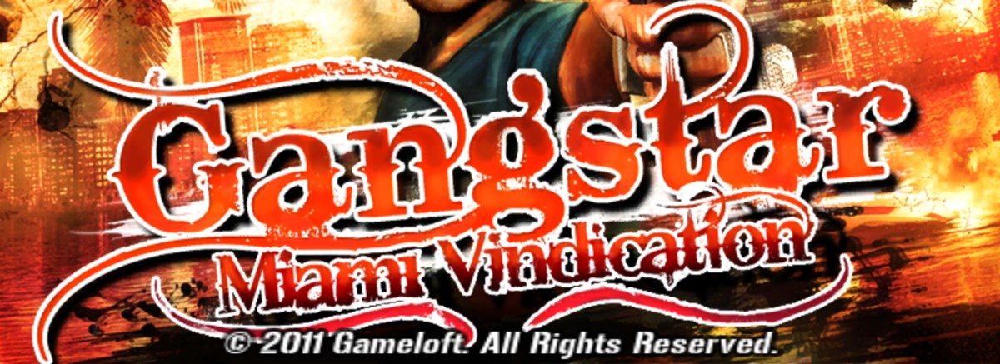
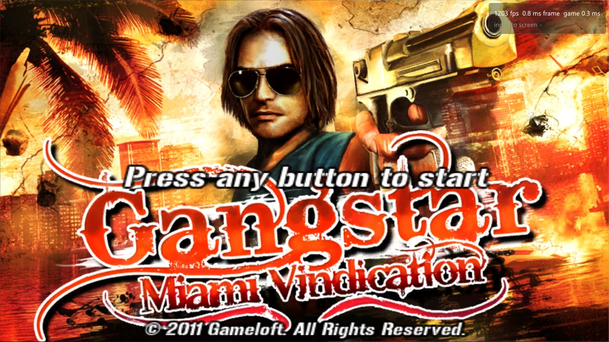
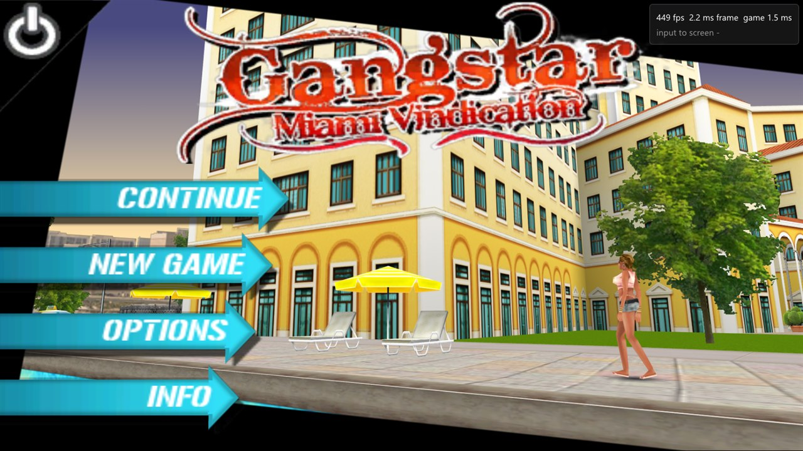
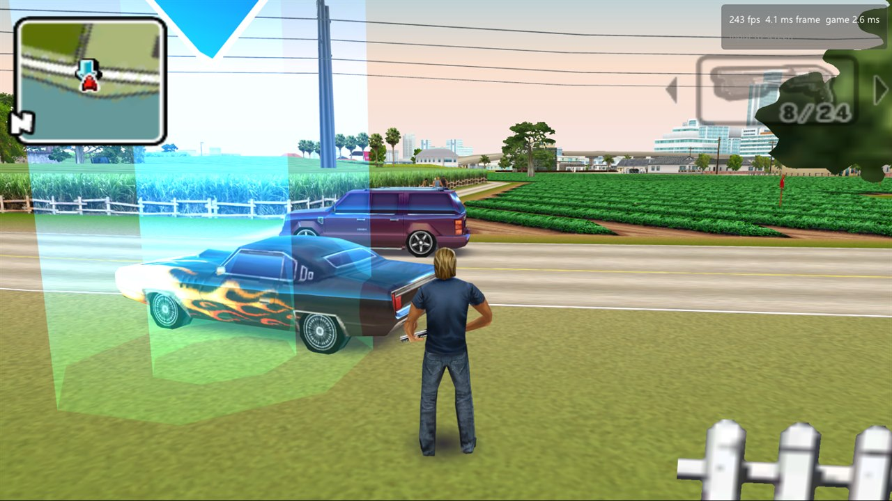
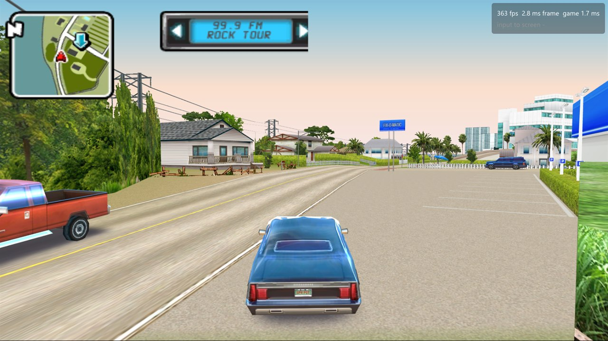
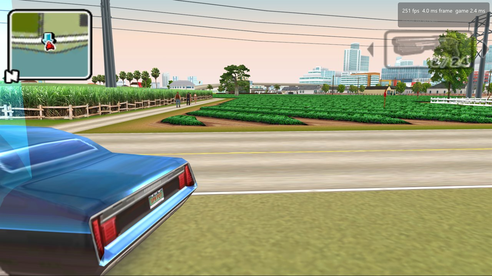
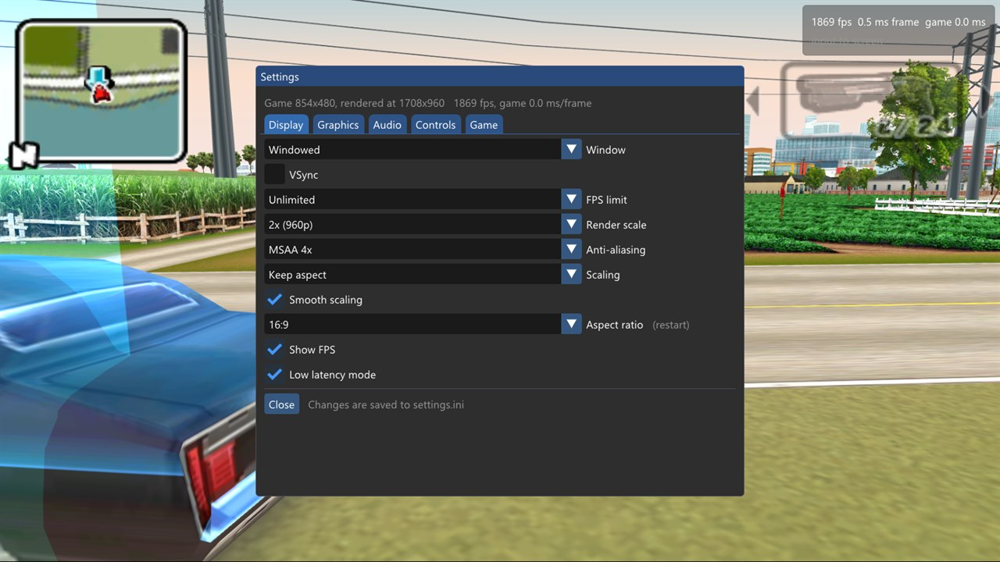
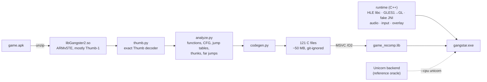

<p align="center">
  
</p>

<h1 align="center">Gangstar: Miami Vindication: Native PC Port</h1>

<p align="center">
  <b>Gameloft's 2011 Android open-world game, statically recompiled from 32-bit ARM to native x86-64.</b><br>
  1.4 million Thumb instructions translated to C and compiled with MSVC. No emulator in the loop, and it runs at 500 fps.
</p>

<p align="center">
  
  
  
  
  
</p>

> [!IMPORTANT]
> **Unofficial fan project.** It isn't affiliated with or endorsed by Gameloft, and *Gangstar* is
> Gameloft's trademark. **No game code or assets are in this repository.** To run it you need your
> own copy of the Android game (the APK and its data folder). Screenshots are for illustration.

## Screenshots

| | |
|:---:|:---:|
|  |  |
| Title screen, 1,280 fps (PC text: "Press any button to start") | Main menu with the store buttons removed |
|  |  |
| On foot at the first spawn, ultra quality, 4× MSAA | Driving with the radio on: 363 fps, 1.7 ms of game logic per frame |
|  |  |
| New first-person camera mode | F1 settings overlay (Dear ImGui) |

## Why this exists

The last Android release (v1.0.6, `com.gameloft.android.GAND.GloftGMHP.ML`) no longer runs on
current hardware:

- **32-bit ARM only** (`lib/armeabi`, ARMv5TE). Recent Arm cores have dropped AArch32, and many
  devices ship 64-bit-only Android builds.
- **`targetSdkVersion` 5.** Android 14+ refuses to install it.
- **Tegra 2 texture build.** All 248 textures are DXT1/DXT5, and most mobile GPUs other than
  NVIDIA's don't expose S3TC.

Emulating the ARM code works. This project did that first (Unicorn), but it reached only about 20 fps.
So the game's native library is now **translated ahead of time into C**, compiled for the host, and
linked against a reimplementation of the parts of Android it talks to.

## Status

| Target | State |
|---|---|
| **Windows x86-64** | ✅ Playable: title screen, menus, intro, on foot, driving, the start of the first mission, radio, audio. Longer sessions and the full story are not verified yet. |
| **Android arm64** (Retroid Pocket 6 / Odin-class handhelds) | 🚧 Next: the same generated C, built for arm64 with SDL2 and a GLES 3 backend |

Known issue: the radio station box is clipped on its right edge.

## Performance

Ryzen 5 5500 + RTX 3060, rendered at 2× (1708×960), ultra quality:

| | Unicorn emulator (`--cpu unicorn`) | **Recompiled** (default) |
|---|---:|---:|
| Game logic per frame, on foot at the spawn | ~49 ms | **1.1–1.6 ms** |
| Game logic per frame, driving | ~47 ms | **1.7–2.9 ms** |
| Frame rate, uncapped, in gameplay | ~20 fps | **380–500 fps** |
| Frame rate, title screen | | **~1,280 fps** |

These numbers come **before** any recompiler-level optimisation. Guest registers still live in a
struct in memory, and every guest call is a real C call (see [Roadmap](#roadmap)).

## How it works



### The binary

`libGangster2.so` holds 3.19 MB of `.text` with **24,199 functions**: 23,415 Thumb and 784 ARM.
The survey decodes all of the Thumb code with **0 undefined instructions**. The library shipped
**with its symbol table**, so every function keeps its real C++ name (`Vehicle::Load`,
`CHudManager::load`, ...). The loader reports 290 imported functions (bionic libc/libm/pthreads,
GLES 1.1, liblog) and a JNI boundary to a small Java layer.

### Translation model

- **One C function per guest function**, `void f_<addr>(RcState* s)`. The registers r0–r15 live in
  `RcState`.
- **NZCV flags are C locals.** AAPCS doesn't keep flags across calls, so the C compiler deletes
  every flag computation that nothing reads.
- **Fastmem.** The guest's 32-bit address space is one 4 GB host reservation, and a guest pointer is
  `base + addr`. A guest load or store is one host instruction. Unmapped pages are
  `PAGE_NOACCESS`, so a wild pointer becomes an access violation, which the crash report maps back
  to a guest address and the guest call chain.
- **PC-relative code becomes constants.** The 8,979 `add rX, pc` (PIC GOT base) and all literal pools
  are folded at translation time. That is safe because none of the 47,173 relocations land in the
  code segment.
- **Control flow.**
  - Branches become labels and `goto`. Tail branches become tail calls.
  - The 227 GCC PIC `mov pc, reg` jump tables become C `switch` statements. Each bound is recovered
    from the `cmp`/`bls` guard **on the path into the table**.
  - Thumb-1 "far jump" `bl` becomes `goto`, while a `bl` to the function's own entry is a real
    recursive call.
- **783 ARM-mode C++ thunks** (`this` adjustment + tail call) are recognised and emitted as two lines
  of C.
- **Soft-float.** armeabi has no FPU instructions, so every float operation is a call to
  `__aeabi_fadd` and friends. 35 of these helpers are emitted **inline as native float/double
  operations**, with ARM VFP semantics for conversions (saturation, NaN → 0).
- **Calls.**
  - Calls through the PLT go straight to host handlers.
  - Indirect calls (vtables, function pointers) use an 8K-entry cache, then a binary search over the
    sorted function table.
  - `setjmp`/`longjmp` (libpng and GLU error paths) use a host `setjmp` inside the guest function's
    frame.
- **Hooks.** Functions that mods patch are wrapped with `rc_hook_enter` / `rc_hook_leave`. The same
  hook API works on both CPU backends.

An illustrative example (not code from the game):

```asm
f:  push {r4, lr}
    ldr  r4, [r0, #8]
    cmp  r4, #0
    beq  1f
    bl   g
1:  pop  {r4, pc}
```

```c
void f_123456(RcState* s) {
  RC_FLAGS;
  { uint32_t a_ = SP - 8u; WR32(a_ + 0u, R(4)); WR32(a_ + 4u, R(14)); SP = a_; }
  R(4) = RD32(R(0) + 8u);
  CMP(R(4), 0u);                    /* n_ z_ c_ v_ are locals: unused ones vanish */
  if (C_eq) goto L_123462;
  LR = 0x10123462u | 1u; f_200000(s);
L_123462:;
  { uint32_t a_ = SP; R(4) = RD32(a_ + 0u); SP = a_ + 8u; }
  return;
}
```

So this is a **recomp, not a decomp**. The output is correct and fast, but it is machine code
written in C syntax, not readable source. A decomp could later grow on top of it, one function at
a time, because any recompiled function can be swapped for hand-written C++.

### The Android around it (HLE)

| Layer | Implementation |
|---|---|
| bionic libc / libm / pthreads | Host reimplementation. File I/O is redirected to the data folder, with an override layer for text changes. |
| OpenGL ES 1.1 | Translated to desktop GL (compatibility profile), drawn into a **virtual framebuffer**: render scale, MSAA, any 480-high aspect ratio, texture filter overrides, anisotropic filtering |
| JNI | A fake `JavaVM` / `JNIEnv`. The Java classes the native code calls (`GLMediaPlayer`, the `Gangster2` activity, ...) are reimplemented in C++. |
| Audio | SDL2 float mixer + stb_vorbis, with the Java media player's semantics |
| Input | Keyboard, mouse and controller mapped onto the game's virtual touch controls, plus mouse look and tilt-steering emulation |
| UI | Dear ImGui settings overlay (F1), FPS counter, toasts |

### Debugging a recompiler: differential execution

The earlier Unicorn-based backend stays in the build as a **reference oracle** (`--cpu unicorn`).
When the recompiled build misbehaves:

1. **`GANGSTAR_FIXED_TIME=1`** makes the clock deterministic, so both backends run an identical boot.
2. **Import traces** (`GANGSTAR_TRACE_IMPORTS`) log every import call with its name, return address
   and r0–r3. [`trace_diff.py`](tools/recomp/trace_diff.py) finds the first call that differs.
3. **Full state dumps** of all guest memory and registers, taken at the *n*-th import call
   (`GANGSTAR_MEMDUMP_AT`) or at the *n*-th entry or exit of **any** game function
   (`GANGSTAR_PROBE`), are compared by [`mem_diff.py`](tools/recomp/mem_diff.py). Bisecting over *n*
   narrows a bug to a few instructions.

Two bugs it found, each within minutes:

- **Recursion compiled as a loop.** The first boot hung forever in a material destructor. The dumps
  were identical at the entry *and* exit of the 8th `releaseProcessBuffer` call, but the 9th came
  from a different caller. That pointed at the red-black tree's `_M_erase`, whose
  `bl _M_erase` (recursion) had been translated like a Thumb "far jump" (`goto`). That affected 232
  functions.
- **A jump table that read its neighbour's bound.** `Vehicle::Load` crashed at the first car load. Its
  table had 2 entries instead of 13, because the bound came from the nearest `cmp` *above* the
  table in address order, which belonged to the next `switch`. The analysis now follows the
  control flow into the table, and that fix corrected two more tables as well.

## Features beyond the original

- Keyboard + mouse (mouse look) and controller support. The on-screen touch controls hide
  automatically.
- **High frame rates.** The frame limiter follows the display by default, or can be set to a fixed
  rate or unlimited. There's also a low-latency mode.
- **Render options:** native resolution (the 480p game rendered at exactly your screen's
  resolution) or 1×–6× supersampling, MSAA, aspect ratios, texture filtering (game / nearest /
  bilinear / trilinear), anisotropic filtering, quality profiles (phone / low / high / ultra) and
  draw distance.
- **Restored day/night look:** the game ships night versions of the whole city (lit windows,
  blue night) but its code to use them was dead, so phones showed a daylight city all night.
  The port swaps them in at night and tints the city through sunrise and sunset to match the sky.
- **Camera modes:** classic (re-centres behind you, like the phone), freeform and first person.
- **Fast forward** (F2 or R3).
- Gameloft LIVE! / More Games store buttons removed. "Press any button to start" replaces the touch
  prompt.
- All of it lives in the F1 overlay and is saved to `settings.ini`.

<details>
<summary><b>Controls</b></summary>

| Action | Controller | Keyboard / mouse |
|---|---|---|
| Move / steer | Left stick | WASD / arrows |
| Camera | Right stick | Mouse (mouse look), else right-drag |
| Fire (auto-aims at the nearest target) | RB | Left click, Left Ctrl (in a car also right click) |
| Aim with crosshair, over the shoulder (hold) | RT (on foot) | Right click (on foot) |
| Lock onto the nearest target | LT (on foot, hold) | Middle click (on / off) |
| Reload | LB (on foot) | R (on foot) |
| Accelerate / brake | RT / LT (in a car) | W / S, Space = brake |
| Sprint | A | Shift or Space (on foot) |
| Cover | B | C or Q |
| Enter / exit car | Y (hold to enter when near) | F or Enter |
| Interact (shop, mission, save) | X | E |
| Weapon prev / next | D-pad left / right | 1 / 2, mouse wheel up / down |
| Map | Back | M |
| Radio on/off, next station | D-pad up / down | T, R or mouse wheel (in a car) |
| Pause / back | Start (B in menus) | Esc |
| Fast forward | R3 | F2 |
| Settings overlay | Guide or L3+R3 | F1 |
| Fullscreen | | F11 / Alt+Enter |

</details>

## Building

**You need:**

- Windows 10/11 x64.
- Visual Studio with the *Desktop development with C++* workload. MSVC, CMake, Ninja and vcpkg all
  come with it. This was tested with VS 2026 (MSVC 19.52); VS 2022 should work but is untested.
- Python 3.10+ with `pip install pyelftools unicorn==2.1.4`.
- [jadx](https://github.com/skylot/jadx), once, to pull the sound-name table out of the Java code.
- **Your own game files:** the APK (v1.0.6) and the data folder from
  `/sdcard/gameloft/games/Gangstar2/`.

```powershell
# 1. Game files (git-ignored, never committed)
#      original\game.apk
#      original\gameloft\games\Gangstar2\...
# 2. Unpack the APK (it is a zip)
mkdir work\apk; tar -xf original\game.apk -C work\apk
# 3. Sound-name table from the Java layer
jadx -d analysis\jadx original\game.apk
python -I tools\extract_sound_table.py
# 4. Build. The first time this generates work\recomp (~50 MB of C) and compiles it: ~10 min.
#    Later builds regenerate and recompile only what changed.
.\tools\build.ps1 -Recomp
# 5. Play
build\win-x64\RelWithDebInfo\gangstar.exe
```

<details>
<summary><b>Command-line options for testing and debugging</b></summary>

| Option | Effect |
|---|---|
| `--cpu unicorn` | Run the emulator backend instead of the recompiled code |
| `--fps N` | Frame limit for this run (0 = unlimited) |
| `--set section.key=value` | Override any `settings.ini` key for this run (repeatable) |
| `--no-mods` | Vanilla game: no hooks, no text changes |
| `--seconds S` | Quit after S seconds |
| `--input "<script>"` | Scripted input, e.g. `t20:tap 427 300; t61:pad y 1; t62:stick l 0 -100` |
| `--shots-at 650,t62.5` | Screenshots at frames or seconds (`build\shots\`) |
| `--open-settings S` | Open the F1 overlay at S seconds |
| `--touch-controls show\|hide\|auto` | On-screen controls |
| `--quality phone\|low\|high\|ultra` | Graphics profile |

| Environment variable | Effect |
|---|---|
| `GANGSTAR_FIXED_TIME=1` | Deterministic clock (1 ms per `gettimeofday`) |
| `GANGSTAR_TRACE_IMPORTS=<file>` | Trace every import call (with `--no-fastpath` on the Unicorn side) |
| `GANGSTAR_MEMDUMP_AT=<n>` | Dump guest memory and registers at import call *n* |
| `GANGSTAR_PROBE=<symbol>`, `GANGSTAR_PROBE_HIT=<n>`, `GANGSTAR_PROBE_EXIT=1` | Dump at the *n*-th entry/exit of a function (recomp side: `codegen.py --probe <symbol>`) |
| `GANGSTAR_RC_SAMPLE=<s>` | Sample the main thread's stack after *s* seconds (hangs) |

The log goes to `build\runtime.log`.

</details>

## Repository layout

```
src/
  recomp/     runtime contract for generated code (rc.h), dispatch, hooks, crash reports
  cpu/        CPU interface shared by both backends; Unicorn backend
  hle/        bionic libc/libm/pthreads, stdio + path redirection, import traps
  gl/         GLES 1.1 → desktop GL, virtual framebuffer
  jni/        fake JavaVM/JNIEnv and the reimplemented Java classes
  audio/      SDL2 mixer, Java media player semantics
  input/      keyboard / mouse / controller → virtual touches, scripted input
  game/       mods (camera modes, HUD, menus, text, fast forward ...)
  ui/         Dear ImGui overlay
tools/
  recomp/     thumb.py · elfinfo.py · analyze.py · survey.py · codegen.py · trace_diff.py · mem_diff.py
analysis/     reports derived from the binary (imports, JNI surface, recompiler survey)
NOTES.md      the full engineering log: every finding, open question and number
PLAN.md       milestones
original/ work/   your game files and everything generated from them (git-ignored)
```

## Roadmap

- **Android arm64.** The same generated C built for arm64 (clang), with SDL2 for Android and a GLES 3
  backend for the GL bridge. Retroid Pocket 6 / Odin-class handhelds are the target, at 120+ fps
  where the display allows. DXT textures will need a software decode path on non-NVIDIA GPUs.
- **Recompiler optimisations.** Cache registers in C locals, skip the hook/dispatch checks where they
  can be proven unnecessary, and try PGO/LTO.
- **Verification.** Longer play sessions and missions, compared with screenshots against the Unicorn
  build.
- Fix the radio box clipping.

## Credits

- Port: **aidencantcode**
- *Gangstar: Miami Vindication* © 2011 Gameloft. All rights to the game, its code and its assets
  belong to Gameloft.
- Built with [SDL2](https://www.libsdl.org/), [Dear ImGui](https://github.com/ocornut/imgui),
  [stb_vorbis](https://github.com/nothings/stb), [Unicorn](https://www.unicorn-engine.org/)
  (reference backend), [pyelftools](https://github.com/eliben/pyelftools),
  [Ghidra](https://ghidra-sre.org/), [jadx](https://github.com/skylot/jadx) and LLVM's objdump.
- Ideas and reference projects:
  [Asphalt5-Native](https://github.com/mrbaazzman/Asphalt5-Native),
  [gtactw_vita](https://github.com/TheOfficialFloW/gtactw_vita),
  [backstab-vita](https://github.com/v-atamanenko/backstab-vita),
  [FalsoJNI](https://github.com/v-atamanenko/FalsoJNI),
  [droidports](https://github.com/JohnnyonFlame/droidports),
  [Bogodroid](https://github.com/binarycounter/Bogodroid) and
  [touchHLE](https://github.com/touchHLE/touchHLE).

## License

No license has been chosen for this project's own code yet. Note that the optional Unicorn backend
is GPLv2.
